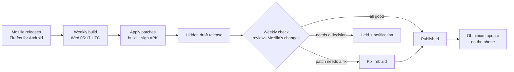

# Firefox+

**Firefox for Android, tuned for people who keep hundreds of tabs open.**

Tab previews that don't disappear, tab groups you can actually manage, and 1,000 recently closed tabs. 
Built every week from Mozilla's official release source.

[Install](https://github.com/KPourush/firefox-plus/wiki/Installing) · [Features](https://github.com/KPourush/firefox-plus/wiki/Features) · [How updates work](https://github.com/KPourush/firefox-plus/wiki/How-Updates-Work) · [Tab Mover](https://github.com/KPourush/firefox-plus/wiki/Tab-Mover) · [FAQ](https://github.com/KPourush/firefox-plus/wiki/FAQ)

---

## Why

Stock Firefox for Android keeps tab thumbnails in a 100 MB cache. Once you open about 100 new tabs, older tabs lose their previews. Firefox+ raises that limit to 8 GB, and adds the tab-management tools that a large tab collection needs.

## Highlights

<table>
<tr>
<td width="50%" valign="top">

### 🖼️ Tab memory
- Thumbnail cache **100 MB → 8 GB**
- Recently closed keeps **1,000** tabs instead of 10
- Recently closed is sorted by when you closed each tab, so an old tab you close still shows up at the top
- Faster tab tray and tab search with many tabs

</td>
<td width="50%" valign="top">

### 🗂️ Tab groups
- Select, move, remove and reorder (**To top / To end**) tabs inside a group
- Tab tray opens straight into the current tab's group
- Search inside an open group
- Controls at the bottom, within thumb reach

</td>
</tr>
<tr>
<td valign="top">

### 🔎 Search & select
- **Select all (N)** matching tabs, then Add to group
- Add to group as a 2-column grid, recently used groups first
- Duplicate tabs follow their newest copy, plus a one-tap sort

</td>
<td valign="top">

### 🧭 Getting around
- Toolbar swipe follows tab tray order, group by group
- Draggable scrollbar to jump through hundreds of tabs
- Installs **next to** the Play Store Firefox (`org.mozilla.firefox_plus`)

</td>
</tr>
</table>

Full details for every change: [Features](https://github.com/KPourush/firefox-plus/wiki/Features).

## Install

1. Install [Obtainium](https://github.com/ImranR98/Obtainium) on your phone.
2. Tap the **Get it on Obtainium** badge above, or add `https://github.com/KPourush/firefox-plus` as a new app.
3. Install Firefox+. Obtainium will offer each new weekly release as an update.

Moving over from regular Firefox? [Tab Mover](https://github.com/KPourush/firefox-plus/wiki/Tab-Mover) carries all your tabs across, in order.

## How updates work

Only reviewed builds are published. More in [How updates work](https://github.com/KPourush/firefox-plus/wiki/How-Updates-Work).

## Patches

Every change lives as a plain `git apply` patch in [`patches/`](patches), applied in order on top of Mozilla's release tag.

<b>All 15 patches</b>

| Patch | What it changes |
|---|---|
| `0001-thumbnail-cache-8gb.patch` | Tab thumbnail cache limit raised from 100 MB to 8 GB, so previews are no longer evicted after ~100 tabs. |
| `0002-tab-search-select-all.patch` | Tab search gets a "Select all (N)" button: selects every matching tab in tab order and returns to the tab tray, ready for Add to group. |
| `0003-separate-app-identity.patch` | App ID `org.mozilla.firefox_plus` and name "Firefox+", so it installs next to the Play Store Firefox. |
| `0004-group-tab-select-move-remove.patch` | Inside an open tab group: long-press selects tabs, with All/None, Move (to another or a new group) and Remove (out of the group). A group emptied this way is removed. |
| `0005-open-current-tab-group.patch` | Opening the tab tray while on a tab that's in a group goes straight into that group, scrolled to the current tab. Back still leads to the overview. |
| `0006-tab-search-in-open-group.patch` | Search button in the header of an open tab group. Back from search returns to the group; Select all returns to the overview with the matches selected, ready for Add to group. |
| `0007-swipe-within-tab-group.patch` | Toolbar swipe follows the tab tray order: through a group's tabs in group order, then on to the next group or tab. It stops at the first and last tab instead of wrapping around. |
| `0008-tab-list-fast-scroller.patch` | Draggable scrollbar on the right edge of the tab list, in its own 24 dp lane: the tabs keep their width and move left into the side margin, so the scrollbar never sits on top of them. In the overview and inside open groups (list and grid view). Hold the thumb and drag to jump through hundreds of tabs. |
| `0009-duplicate-tabs.patch` | Adding a tab to a group also pulls in every other copy of the same page (from anywhere), placed right after the new tab, newest to oldest. A sort button next to tab search moves every older copy directly after its newest copy and into that copy's group (or out of any group if the newest is ungrouped); it shows a spinner while working and a message when done. Groups left empty are removed. Pages count as the same when their address matches, ignoring the part after `#` and a trailing `/`. Nothing is closed automatically. |
| `0010-add-to-group-grid.patch` | The Add to group sheet shows groups as a 2-column grid of tiles (group color bar, name on up to 2 lines, tab count), with New group as the first tile. Groups you last added tabs to come first; closing, reading or renaming tabs doesn't change the order. |
| `0011-group-move-to-top-end.patch` | Inside an open tab group, the selection bar gets a second row: Move, Remove, To top, To end. To top / To end move the selected tabs to the beginning or end of the group, keeping their order, then leave selection; the list stays where it was. |
| `0012-group-buttons-at-bottom.patch` | An open tab group always opens at full height and closes with a single Back. Only the group's title stays at the top; search, the ⋯ menu and add tab sit in a bar at the bottom, and in selection mode the selection bar (✕, count, All/None, Move, Remove, To top, To end) is at the bottom too. |
| `0013-add-to-group-full-height.patch` | The Add to group sheet opens at full height, so scrolling the groups doesn't stop partway while the sheet pulls itself open. |
| `0014-tab-tray-performance.patch` | The tab list is only rebuilt when something it shows changes (title, address, icon, playing media, selected tab, groups), not on every page-loading update, and an outdated rebuild is dropped when a newer one starts. Tab search cancels the previous search on each keystroke and only shows results for the newest query. Sorting duplicates saves group changes once per group instead of once per page. |
| `0015-recently-closed-1000.patch` | Recently closed keeps the last 1,000 closed tabs instead of 10. |
| `0016-recently-closed-by-close-time.patch` | Recently closed is sorted by when each tab was closed instead of when it was last opened, so closing an old tab puts it at the top instead of the bottom (where it could be pruned straight away). |

## Building and maintenance

- [`.github/workflows/build.yml`](.github/workflows/build.yml) runs weekly (Wednesdays). It picks the newest `FIREFOX-ANDROID_*_RELEASE` tag, applies the patches, builds with Mozilla's prebuilt engine (artifact build), signs the APK and creates release `v<version>`. Versions that were already built are skipped. Run it by hand under **Actions → Build Firefox+ → Run workflow**. Builds run by hand publish directly unless *draft* is ticked.
- Scheduled builds are hidden drafts until the weekly check (a scheduled Claude task, Wednesdays 11:38 Berlin time) has reviewed them. It publishes them through [`publish.yml`](.github/workflows/publish.yml).
- After changing the patches, raise the number in [`REVISION`](REVISION) so the rebuild gets a new release name (`v<version>-r<N>`) that Obtainium sees as an update.
- Required repository secrets: `KEYSTORE_B64`, `KEYSTORE_PASSWORD`, `KEY_ALIAS`.
- The wiki is written in [`wiki/`](wiki) and copied to the Wiki tab by [`wiki.yml`](.github/workflows/wiki.yml).

See [Development](https://github.com/KPourush/firefox-plus/wiki/Development) for adding or updating a patch.

## Tab Mover

[`tab-mover/`](tab-mover) is a small extension for moving tabs between the old Firefox and Firefox+: export all tabs in order to a JSON file, then re-open them in order without loading them all at once. Optional: paste a shared tab group's links to mark those tabs with `#ffg`, then search `#ffg` → Select all → Add to group.

---

Firefox+ is a personal, unofficial build and is not affiliated with or endorsed by Mozilla. Firefox is a trademark of the Mozilla Foundation. The source code is Mozilla's, under the <a href="https://www.mozilla.org/MPL/2.0/">Mozilla Public License 2.0</a>; the patches here apply on top of it.
