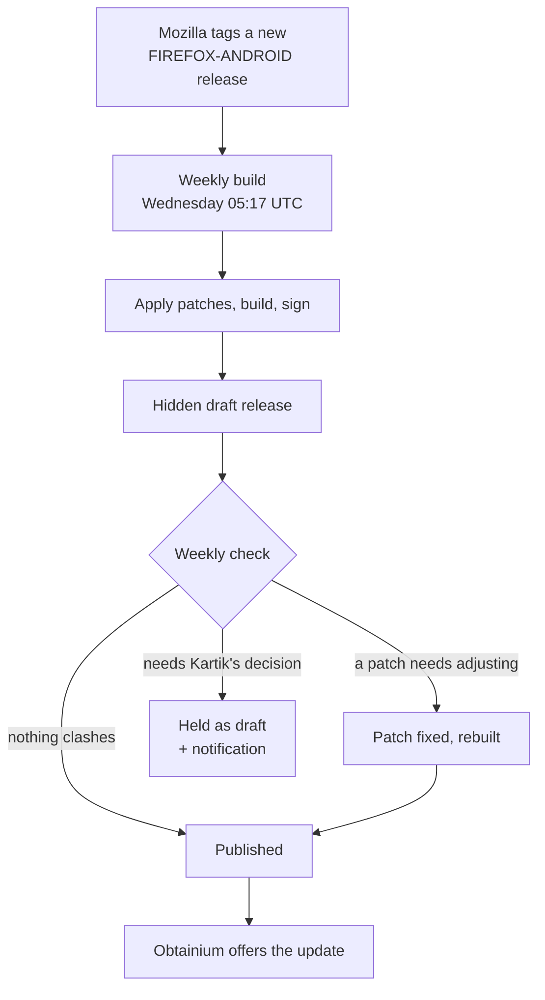

# How updates work

Every Firefox+ release is Mozilla's latest Firefox for Android release with the Firefox+ patches applied. Nothing reaches your phone until it has been checked.

## 1. The weekly build

[`build.yml`](https://github.com/KPourush/firefox-plus/blob/main/.github/workflows/build.yml) runs every Wednesday. It:

1. Picks the newest `FIREFOX-ANDROID_*_RELEASE` tag from [mozilla-firefox/firefox](https://github.com/mozilla-firefox/firefox). If that version was already built, it stops.
2. Applies every file in [`patches/`](https://github.com/KPourush/firefox-plus/tree/main/patches) in order with `git apply`.
3. Builds the app with Mozilla's prebuilt engine (artifact build), so only the Android app layer is compiled.
4. Signs the `arm64-v8a` APK and creates release `v<version>` (or `v<version>-r<N>`) as a **hidden draft**.

## 2. The weekly check

A scheduled task (Wednesdays, 11:38 Berlin time) reviews the draft before anyone gets it:

- It lists every change Mozilla made between the previous release and the new one to the files the patches touch, and compares them with what each patch does.
- It looks for real clashes: Mozilla shipping its own version of a Firefox+ feature, a separate mechanism that undoes one (for example another thumbnail-cache limit), or changed behaviour that a patch relies on.
- If GitHub's schedule is late, it starts the build itself. If GitHub's build machine fails, it re-runs the build.

Then it does one of three things:

| Result | What happens | Notification |
|---|---|---|
| ✅ Nothing clashes | The draft is published through [`publish.yml`](https://github.com/KPourush/firefox-plus/blob/main/.github/workflows/publish.yml). | None |
| 🔧 A patch needs adjusting, and the fix keeps the same behaviour | The patch is updated, `REVISION` is raised, the app is rebuilt, checked and published. | One line: what was fixed |
| ✋ Needs a decision (e.g. Mozilla now has the same feature) | Nothing is published; the update waits. | One line: why it's held |

## Version names

- `v160.0.1`: Firefox 160.0.1 with the patches.
- `v160.0.1-r15`: the same Firefox version, patch revision 15. The revision comes from the [`REVISION`](https://github.com/KPourush/firefox-plus/blob/main/REVISION) file and is raised whenever the patches change, so Obtainium sees a rebuild as an update.
